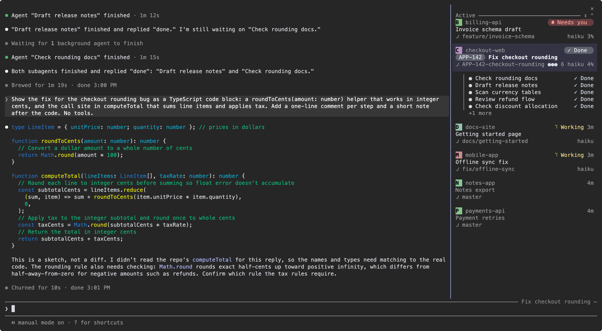
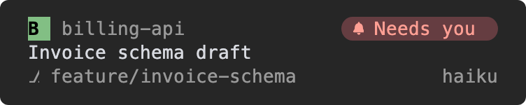
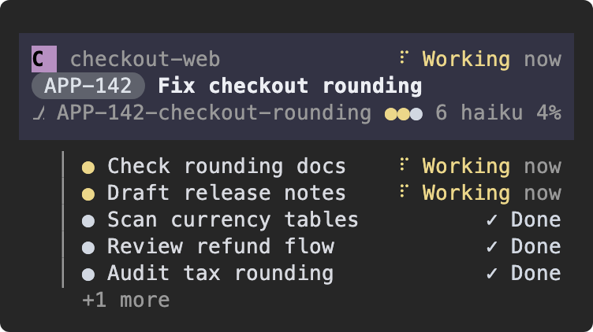
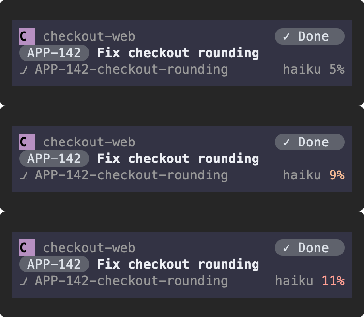
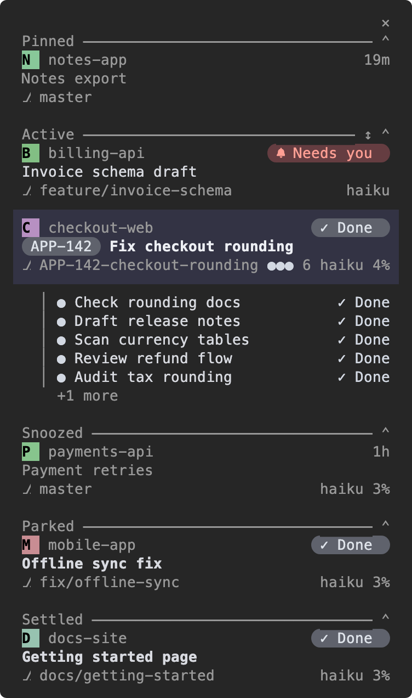
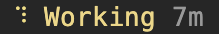
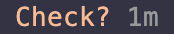
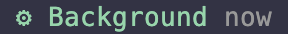
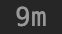

# Bridge

Bridge lists every Claude Code session on your machine beside the chat, so you see which one needs an answer without opening terminal tabs.



*Dark theme, Nerd glyphs. The coloured letter is the project icon (a monogram here). `APP-142` is an issue id read from the branch name (see `/bridge tickets`). `×` closes the pane.*

## Install

```sh
claude plugin marketplace add dbohorquez8/ai
claude plugin install bridge@dbohorquez
```

Start a new session; Bridge opens by itself, and `/bridge` opens it again. In a wide fullscreen terminal the pane docks beside the chat; in a narrower window it sits above the prompt.

## What you get

### Find the session that needs you

A session that waits for an answer shows a red **Needs you** pill and sorts to the top of the list. Press its card to jump to that session's tab. A short chime plays when a session starts needing you or fails.



### Keep a subagent fan-out in view

Your own session's card shows its subagents as child rows below it. A moving yellow dot means that child is running; finished rows stay. Up to five rows show, then `+N more`. Press a child row to read that child's transcript. The card's third line sums them up: one dot for each of the first three subagents, coloured by status, then the total, such as `●●● 6`.

Bridge adds a `report_tickets` tool. Your session sends it every ticket with its state (planned, in progress or done) and, when a worker carries it, that worker's agent id; each report replaces the previous list, and an empty list clears it. While the report holds tickets, the card shows ticket progress. The title line ends with a bar of one coloured segment per ticket (green done, blue in progress, gray planned) and a count of done tickets, such as `1/4`. When the bar is crowded, tickets of the same state merge into one run; on a narrow pane the bar drops out and only the count stays. When the report names an epic, or every id shares a prefix such as `APP`, a chip with it opens the title line. The subagent rows below the card stay as they are. Bridge never reads ticket ids from a subagent's description or name.



### Know when a long conversation needs a fresh start

The percentage at the right of a card's third line is how full the model's context window is. Its colour follows a soft limit, the token count at which you want to start a fresh session: orange at 75% of the limit, red at 100%. Set it with `/bridge soft-limit 150k`.



*A soft limit of 100k tokens: muted below 75k, orange from 75k, red from 100k. The percentage is the share of the model's whole window, so it stays low on a 1M-token model.*

### Put cards aside

Hover a card for its actions (not pictured). **Pin** keeps any card on top, and `↑` `↓` reorder the Pinned shelf. An idle or done card also offers **Snooze**, **Park** and **Settle**, which move it to its own shelf until its session works, needs you or fails; a snooze also ends when its time runs out, and a parked or settled card also returns when its session finishes a new turn.

Press a shelf header to open (`⌃`) or collapse (`⌄`) it. The `↕` on the Active header sorts that shelf by recent activity, date created or project; cards that need you or failed stay on top.



Sessions idle for 6 hours move to a collapsed Inactive shelf.

## Statuses

Each card shows one status at the right end of its first line.

| Status | Looks like | Meaning |
|---|---|---|
| **Needs you** |  | The session waits for you: a permission prompt, a plan to approve, or a question. |
| **Working** |  | A turn is running. |
| **Check?** |  | Your own session's background work has been silent for 15 minutes (see `check-after`). |
| **Failed** |  | The last turn ended on an error, such as an API error. |
| **Background** |  | Your own session finished its turn while background tasks still run. They show as rows under its card. |
| **Done** |  | A turn finished that you have not looked at yet. Pressing the card makes it Idle. |
| **Waiting** | A green `Waiting` and its age | Your own session is idle, but a subagent still works. It returns to Idle when the last one finishes; a Done card stays Done. |
| **Idle** |  | Nothing is going on and you have seen the last result. |

When more than one status applies, the first one in the table shows. A snoozed card shows the time left, such as `2h`; a card back from snooze shows **Woke** until you press it, or **Waiting** while it is idle and a subagent works (not pictured).

## Settings

Every setting is a `/bridge` argument and persists across sessions.

| Command | Values | Default | Effect |
|---|---|---|---|
| `/bridge icons` | `on`, `off` | `on` | Project icons or monograms. |
| `/bridge working-shelf` | `on`, `off` | `off` | Working sessions on their own shelf. |
| `/bridge theme` | `auto`, `light`, `dark` | `auto` | `auto` follows Claude Code's theme. |
| `/bridge glyphs` | `auto`, `nerd`, `plain` | `auto` | Rounded pills and a bell, or square pills and `!`. |
| `/bridge tickets` | id prefixes, `off` | `off` | Shows an issue id such as `APP-142` as a chip before the title (branch chip); `/bridge tickets APP-,OPS-`. |
| `/bridge soft-limit` | token count, `off` | 100k, or 300k above a 200k window | Where the context colour turns orange and red. |
| `/bridge check-after` | minutes, `off` | 15 | How long background work stays silent before **Check?**. |
| `/bridge sound` | `on`, `off` | `on` | The chime. |

## Compatibility

| Terminal | Tab focus | Project pictures |
|---|---|---|
| Ghostty, cmux | Yes | Yes |
| iTerm2 | Yes | With `CLAUDE_CODE_FORCE_TERMINAL_IMAGES=1` |
| tmux, Terminal.app | Yes | Monograms |
| kitty | No | Yes |
| Anything else | No | Monograms |

Tab focus works only within the same terminal app; elsewhere a press copies a resume command. Project pictures need 24-bit colour. Tab focus in Ghostty, Terminal.app and iTerm2 needs macOS. The optional GitHub CLI `gh`, signed in, adds pull request numbers.

## Limits

- Bridge never resumes a session itself; it focuses the tab or copies `claude --resume`.
- Sessions in other terminal apps show dimmed and cannot be focused.
- Subagent and background rows appear under your own session's card only.

## What it touches

Bridge reads Claude Code's session files on this machine and writes only its own settings. To find which terminal tab runs each session, it lists processes with `ps`, including their environment variables; a press runs that terminal's own command to focus the tab. If `gh` is installed and signed in, Bridge runs `gh pr list`, which asks GitHub for pull request numbers. Nothing else leaves your machine. It also keeps the ticket list your session reports to its ticket tool in that same storage, for up to 7 days.

## Credits and licence

MIT, see [LICENSE](../../LICENSE). Includes code adapted from MIT-licensed projects; their notices are in [THIRD_PARTY_NOTICES.md](THIRD_PARTY_NOTICES.md). Not affiliated with or endorsed by Anthropic.
