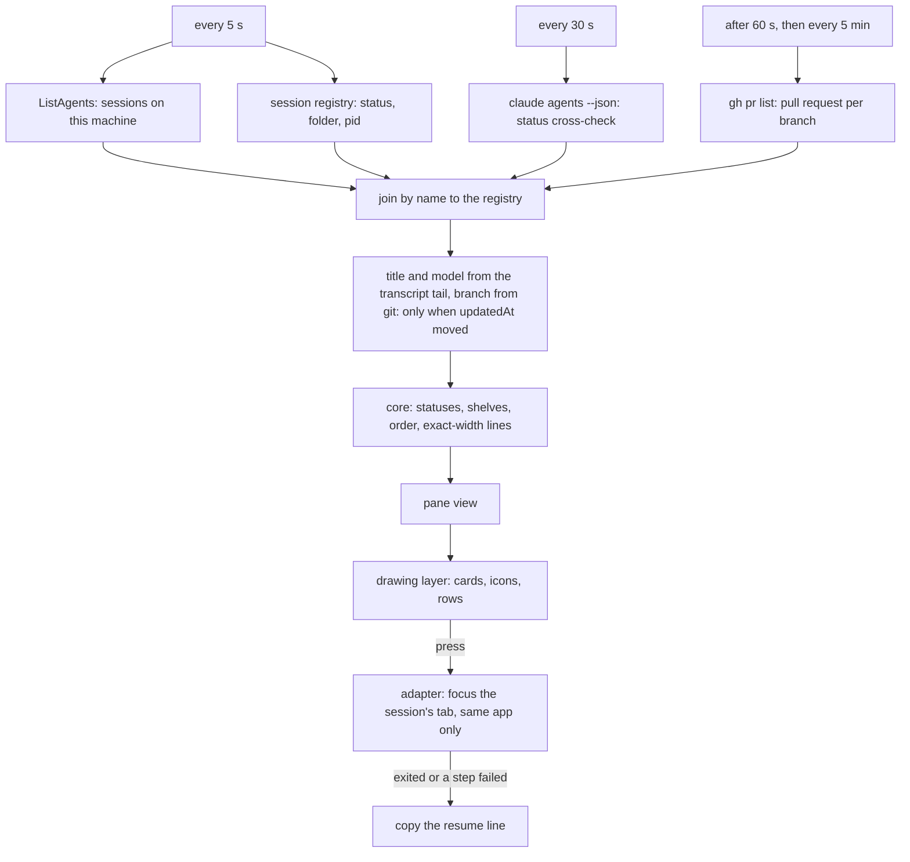

# Bridge Plugin

Bridge is a sessions sidebar for Claude Code.
A pane docked beside the transcript lists this machine's Claude sessions as cards on shelves,
refreshed every 5 seconds. Each card shows the project in its own color, the status and time in that
status, the session's title, and its branch, model, pull request and context use. Each card starts
with the project's icon, found from a fixed list of candidate files. Pressing a card brings forward the
terminal tab that already runs the session, within the same terminal app as the pane. Pressing a
subagent row shows its transcript in the main view.

```
Pinned ───────────────────────────────── ⌄
 ▄▄▄  Workspace                 ⠋ Working 5m
 ███  Fix the cards
 ▀ ▀  ⎇ cards ●●● 3 opus #412 62% ▰▰▱▱
  │ ● Scan repo                  RUNNING 2m
  │ ● Write notes                 DONE 1m
Active ───────────────────────────────── ⌄
 ▄▄▄  AI-Docs                🔔 Needs you
 ███  Review the plan
 ▀ ▀  input needed ⎇ main sonnet
 ▄▄▄  Workspace                         2h
 ███  Docs title
 ▀ ▀  ⎇ docs
Working ──────────────────────────────── ⌄
 Koombea Port the lifecycle     ⠙ Working 9m
Inactive (3) ──────────────────────────── ›
Snoozed (1) ───────────────────────────── ›
Parked (2) ────────────────────────────── ›
Settled (4) ───────────────────────────── ›
```

> **A row never switches this terminal to another session.** Claude Code refuses to open a session
> that another process holds, so the pane focuses the tab that runs it instead, and only within the
> same terminal app (cmux, tmux, Ghostty, Terminal.app or iTerm2). A live session in another app
> gets a note (`<name> runs in Ghostty`) and nothing is copied. When a session has exited, or a
> focus step fails, the row copies `cd '<dir>' && claude --resume <session id>` and the note under
> the list names the step that failed. A press shows no popup.

## Compatibility

| Field | Value |
|-------|-------|
| **Format** | `claude-plugin` (a hooks module) |
| **Works with** | `claude-code` 2.1.302 or later; the pane docks in a fullscreen terminal of 110 columns or more, narrower it sits above the prompt |
| **Scope** | General-purpose |
| **Author** | David Bohórquez |

## Skills

No skills. It adds one command.

| Command | Description |
|-------|-------------|
| `/bridge` | Open the Bridge pane (it also opens by itself at every session start) |
| `/bridge icons on\|off` | Show or hide the project icon at the start of each card; default on |
| `/bridge working-shelf on\|off` | Show the Working shelf, with working sessions as one line each; default off |
| `/bridge theme auto\|light\|dark` | Pick the palette; `auto` follows Claude Code's theme; default auto |
| `/bridge tickets WS-,AID-\|off` | Set the ticket prefixes whose ids show as a chip before the title; default off |
| `/bridge soft-limit 150k\|off` | Set where the context percentage turns orange (75%) and red (100%); default 150k, `off` measures against the full window |
| `/bridge sound on\|off` | Turn the needs-you chime on or off; default on |

## What the pane shows

### Shelves

Each card sits on exactly one shelf. A header shows the shelf's name and a rule; press it to collapse
or expand the shelf. A collapsed shelf shows its count in brackets and no cards. Pinned, Active and
Working start open; Inactive, Snoozed, Parked and Settled start collapsed. The state is kept across
sessions and shared by every pane.

| Shelf | What goes there |
|-------|-----------------|
| **Pinned** | Cards you pinned |
| **Active** | Sessions that need you, idle and done sessions, anything that woke from a snooze, and working sessions while the Working shelf is off |
| **Working** | Only while `/bridge working-shelf on` is set (off by default): sessions that are working, drawn as one line each (a pinned working card stays a full card) |
| **Inactive** | Idle sessions with no activity for 6 hours |
| **Snoozed** | Cards you snoozed; the time left shows on the right |
| **Parked** | Cards you parked; they return to Active when they start working, need you or finish |
| **Settled** | Cards you settled (finished with, but kept); they return the same way |

An empty Active shelf shows a scene: line-art hills with `All clear. Time to touch some grass.`,
or, while any session works, a creature at a laptop with a working caption. Scenes need 24-bit
color; without it the caption shows alone.

### Statuses

| Status | Shown as |
|--------|----------|
| **Working** | A spinner, `Working` and the time in that status |
| **Needs you** | A red pill with a bell that rings every few seconds; the reason (`input needed` when none is given) leads the third line |
| **Failed** | A red `✕ Failed` pill: this session's last turn ended on an API error (until you press the card, a later turn ends well or you send the next prompt), or any session's status word is `failed` or `error` |
| **Check?** | Yellow `Check?` and the time: this session is idle but its last stop still listed background tasks |
| **Done** | A gray `Done` pill, until you press the card |
| **Idle** | The time since the session last changed |

Failed cards sit on the Active shelf, after the Needs you cards. A Check? card sits on Active unless
you parked, snoozed or settled it. Other
sessions never show Check?: only this session's stops list its background work. The time counts from when the status began. When Claude Code's registry
and `claude agents --json` disagree, the source that changed more recently wins.

### Project icons

A card's first line starts with the project icon, 2 columns wide and 1 line tall, then one space,
then the project name; the Working shelf's one-line cards carry it too. The icon is the project's own
picture: the first of the candidate files (`favicon.svg`, `favicon.ico`, `favicon.png`,
`icon.svg`, ... `.idea/icon.svg`) that exists in the project's folder (the main checkout for a
worktree). It is converted once to a 64-pixel PNG in `${CLAUDE_CONFIG_DIR:-~/.claude}/bridge/icons/`
(`sips`, or Quick Look for SVG) and each folder is looked at again at most every 10 minutes.

A picture is drawn where the terminal draws pictures and 24-bit color: Ghostty, cmux and kitty;
iTerm2 when Claude Code started with `CLAUDE_CODE_FORCE_TERMINAL_IMAGES=1`; never inside tmux or in
Terminal. Elsewhere, or when the project has no picture, the icon is a monogram: the project name's
first letter (generic leading words skipped) on the project's color. Below 30 columns icons are hidden. `/bridge
icons off` turns them off. Animation runs at 10 frames per second at most,
and only while something visible moves.

### Card details

- **Line 1:** the project icon, then the project in its own color (bold on this session's card), then the status.
- **Line 2:** the title (bold on a Done card not yet pressed): the transcript's last `ai-title` record, else the first line of its
  `last-prompt` record, else the session's name.
- **Line 3:** `Woke ·`, the reason when the session needs you, `⎇ <branch>`, a badge of subagents
  (this session only), the model (`opus`, `sonnet`, `haiku`), `#<pull request>`, and context use
  as a plain percentage of the model's window (`62%`). Its color is muted, orange from 75% of
  the soft limit, red at 100% (`/bridge soft-limit`, default 150k tokens). When the token count is
  unknown, the color follows the percentage itself. When the line is too narrow, the context, pull request, model and badge drop first,
  then the branch is cut, then the reason.
- **This session's card** has a filled background. Its context use comes
  from the session itself; another session's comes from the registry when it reports one.
- **A session in another terminal app** is drawn dim, with the app's name after the project.
- **Subagents** sit under this session's card behind a `│` rule: a dot, the description, a tag
  (`RUNNING`, `WAITING`, `DONE`, `FAILED`, `STOPPED`) and its age. Waiting rows are tinted. Up to 5
  show, then `+N more`.
- **Background tasks** of this session follow its subagents, one row each: `⟳`, the kind (`Command`,
  `Monitoring`, `Workflow` or `Agent`), the command, workflow name or description, and the time since
  the pane first saw the task. Up to 3 show, then `+N more`. The list is the one Claude Code hands to
  each stop; a finished task wakes the session, and that turn's stop refreshes the rows.

### Pin, snooze, park and settle

Hover over a card to see its actions. Pin keeps a card at the top. Snooze, Park and Settle are
offered for idle and done cards only: a session that works or needs you cannot be hidden. Snooze
offers `1 hour`, `5 hours`, `This evening`, `Tomorrow morning` and `Next week`; a snoozed card wakes
at that time, or earlier if it starts working or needs you, and says `Woke`. Pressing a done or woke
card clears its mark.

### Sort

The `↕` control on the Active header sorts by `Recent activity`, `Date created` or `Project`.
Sessions that need you always come first, longest waiting first. Only Pinned cards keep a
manual order: `↑` and `↓` on a pinned card move it by one place.

### Settings

The pane has no settings rows: every setting is a `/bridge` argument (see the command
table above), kept across sessions in the shared store.

- `theme`: `auto` follows Claude Code's theme (a theme name starting with `light` is light, anything
  else is dark); `dark` and `light` override it. An unreadable theme reads as dark.

When a card changes into Needs you or Failed, the session plays one short chime (`afplay` on macOS;
other systems play nothing). A card that is parked, settled or snoozed stays silent, and so does what
was already there when the pane opened; a card that appears later already needing you chimes. Every session runs the pane, so the change is claimed in the
shared store (`chime:<id>`) and only the first session to claim it chimes. `/bridge sound off` turns
the chime off (`setting:sound`). A known limit: the claim names the registry's status time, so a
session with no registry entry, or whose `claude agents` listing leads the registry, can miss a
repeat chime.

Dark and light palettes come from the Workspace design tokens, and every color the pane picks is
adjusted until it reaches a 4.5:1 contrast ratio against the pane background.

## How it works



### Three layers

The code is split so that nothing outside one folder knows about the terminal.

| Layer | Folder | Job |
|-------|--------|-----|
| **Core** | `hooks/core/` | Pure logic: merges the sources, decides statuses and shelves, orders cards, builds every line to its exact width, picks colors and animation frames. Knows no terminal and no runtime handle. |
| **Drawing** | `hooks/render/` | Paints the core's view model as Claude Code elements. Decides nothing. |
| **Adapters** | `hooks/adapters/` | One file per terminal (cmux, tmux, Ghostty, Terminal.app, iTerm2): finds a session's tab, focuses it, and says what the terminal can draw. |

`hooks/register.tsx` is the only file that talks to Claude Code (timers, store, pane); it wires the
layers together. `tools/check-sidebar-layers.sh <plugin dir>` fails when a core file imports across a
layer or names a terminal:

```bash
sh tools/check-sidebar-layers.sh plugins/bridge
```

An unrecognised terminal still gets every list, shelf, sort and status rule; it only loses tab
focus.

### Data sources

- **Session registry** (every refresh). Every 5 seconds the mod reads Claude Code's session
  registry, `~/.claude/sessions/*.json` (`sessionId`, `name`, `cwd`, `pid`, `status`, `updatedAt`,
  `statusUpdatedAt`, `waitingFor`, and `contextPercent` when present), with `cat` through
  `$.process` (under `$CLAUDE_CONFIG_DIR` when that is set). Token files in the same folder are
  never opened. **The registry is internal and undocumented**: it can change in any release. When it
  cannot be read, or a name is missing or appears twice, the card keeps its name and says resume is
  unavailable; a ref is never shown as an id.
- **`ListAgents`** (every refresh). Gives a short ref, not a session id, so the mod joins each row by
  name to the registry. It leaves out the calling session, whose card comes from its own registry
  entry.
- **`claude agents --json`** (every 30 seconds, first run 30 seconds after session start). A
  cross-check of each session's status. It runs on its own timer, never inside the 5-second refresh,
  because each call costs about 0.17 CPU-seconds. Background entries are ignored. If the command is
  missing or prints nothing readable, the registry alone decides.
- **Transcript tail** (only when a session's `updatedAt` moved). Reads the last 256 KB of
  `<config dir>/projects/<slug of cwd>/<sessionId>.jsonl` for the title and the model, in every
  mode; the whole file is never read.
- **Git** (only when a folder's newest `updatedAt` moved). The branch and the project name per
  folder; a worktree takes its main checkout's name.
- **Pull requests.** `gh pr list --head <branch> --state all --json number --limit 1`, one process per
  distinct folder and branch (at most 10), first run 60 seconds after session start, then every
  5 minutes. A missing or signed-out `gh` turns lookups off for the rest of the session.
- **This session.** `$.agent.list()` for subagents, `$.session.usage()` for context use, and the
  `background_tasks` the engine hands the `Stop` and `SubagentStop` hooks for the task count.
- **Project icons.** `$.fs` checks the candidate files; one `sips` or `qlmanage` process converts a
  picture not yet cached.
- **Plugin store** (`$.store`). One entry per session (`pref:<session id>`, holding pin, park,
  settle and snooze), plus `shelves`, `sort`, `layout` (the pinned order), `setting:icons`,
  `setting:theme`, `setting:tickets`, `setting:softLimit` and `scene:caption`. Every write changes one entry only, so two panes changing
  different sessions both persist; for the same entry the later save wins. A value that fails its
  check is replaced by its default and the note reads `The saved layout was reset.` Entries of
  sessions not seen for 30 days are deleted.

A refresh where no session changed starts at most two processes. All the changed sessions are read
in one process, and all the changed directories in another.

### Pressing a card

Pressing a session card first tries to focus the session's tab (see
[Focusing a session's tab](#focusing-a-sessions-tab)). When that cannot happen, it copies
`cd '<cwd>' && claude --resume <sessionId>` (`--resume` looks a session up per project directory)
and shows it under the list. The mod never resumes a session by itself. Pressing this session's own
card returns the main view to this session.

## Focusing a session's tab

The pane finds its own terminal once at session start: cmux by its `CMUX_*` variables (these win
over `TERM_PROGRAM=ghostty`, as cmux embeds Ghostty), tmux by `TMUX` and its server socket, else the
terminal app among its parent processes, else `TERM_PROGRAM`. A press focuses a session only when
the session runs in that same place: the same app; for tmux, the same tmux server socket; for cmux,
the same cmux instance (`CMUX_SOCKET_PATH`), any workspace.

A live session anywhere else makes no call and copies nothing: Claude Code would refuse to resume a
session that runs in another terminal. Its card is drawn dim with the app's name after the project,
and a press says `<name> runs in <app>` under the list (`another tmux server`, `another cmux` for the
same app on another socket). A live session in an unrecognised terminal says
`<name>: terminal unknown`.

During each 5-second refresh the mod looks up every new session's process (the registry `pid`)
with one `ps` call for all of them and finds its terminal: first from the process's environment
(`CMUX_SURFACE_ID`, `CMUX_SOCKET_PATH`, `TMUX`, `TERM_PROGRAM`), then from its parent processes.
Only those variable names are read; the rest of the environment is never kept or shown. The result
is kept in memory per `pid` and registry `startedAt`, and dropped when the session leaves the
registry, so a press runs no lookup. A press that finds nothing kept looks the process up then.
Each terminal's focus steps run as one process, so a cached cmux press runs exactly one command.

Every terminal below switches within the same app only.

| Terminal | How the tab is found | Permission |
|-------|-------------|------------|
| **cmux** | The workspace and surface ids in the session's environment (else its tty in `cmux tree --all --json`), then `select-workspace` and `focus-panel` in one `sh -c` call that first checks the process still runs. The CLI is looked for at `$CMUX_BUNDLED_CLI_PATH`, then `/Applications/cmux.app/Contents/Resources/bin/cmux`, then `cmux` on `PATH` | None |
| **tmux** | The pane whose tty is the session's (panes and clients in one `tmux` call), then `select-window` and `select-pane` (`switch-client` when the client shows another session) in one more `tmux` call | None |
| **Ghostty** | One AppleScript call: the terminal whose working directory is the session's folder, **when exactly one terminal has it**. Two tabs in one folder are told apart by the session's title when it is unique; otherwise the press says `Ghostty: the folder is shared by 2 tabs` | None |
| **Terminal.app** | AppleScript: the tab whose `tty` is the session's | One-time macOS Automation prompt ("… wants to control Terminal") |
| **iTerm2** | AppleScript: the session whose `tty` is the session's, with its tab and window | One-time macOS Automation prompt ("… wants to control iTerm2") |

The Automation prompt names the terminal app that runs Claude Code, not Claude Code. If it was
declined, the note under the list says so; allow it in **System Settings > Privacy & Security > Automation**.

Other hosts (VS Code, Cursor, kitty, WezTerm, a session with no terminal) are not supported for
switching: a live session there gives `<name>: terminal unknown`, and a press from a pane in such a
host copies the resume line. A session whose process has exited copies the resume line.

### Terminal support

| Terminal | Tab focus | Pictures and scenes | Notes |
|-------|-------|-------|-------|
| **cmux** | Yes | Pictures; scenes with 24-bit color | Detected by its `CMUX_*` variables, ahead of Ghostty |
| **tmux** | Yes | Monograms; scenes with 24-bit color | Per tmux server |
| **Ghostty** | Yes | Pictures; scenes with 24-bit color | Two tabs in one folder are told apart by title; otherwise `Ghostty: the folder is shared by 2 tabs` |
| **Terminal.app** | Yes | No (no 24-bit color) | Monograms stand in for pictures |
| **iTerm2** | Yes | Pictures with `CLAUDE_CODE_FORCE_TERMINAL_IMAGES=1`; scenes with 24-bit color | |
| **Anything else** | No | Pictures in kitty; scenes with 24-bit color | Lists, shelves, sort and status all work; a press on a live session says `<name>: this terminal is not supported for switching. Copied: <line>` |

## Works well with

| Plugin | Why |
|--------|-----|
| [`koombea-orchestrator`](../koombea-orchestrator/README.md) | The task sessions it launches show up as cards; in cmux or tmux a press brings a task's tab forward |

## Requirements

- Claude Code 2.1.302 or later (hooks modules, `ListAgents`, docked panes).
- A fullscreen terminal of 110 columns or more for the pane to dock beside the transcript;
  narrower, it sits above the prompt. The pane asks for a 44-column dock; a width you drag wins.
- Claude Code's internal session registry, `~/.claude/sessions/*.json`, for session ids and
  resume lines. It is undocumented; if a release changes it, cards still list but say resume is
  unavailable.
- 24-bit color (`COLORTERM=truecolor` or `24bit`) for project pictures and scenes.
- macOS `sips` and `qlmanage` to convert project pictures (without them, monograms show).
- `tail`, `grep` and `git` for titles, models and branches.
- Optional: the `claude` CLI on `PATH` for the status cross-check, and `gh` (signed in) for pull
  request numbers.
- To focus tabs: `ps` and `sh`; the `cmux` CLI or `tmux` for those hosts; macOS with `osascript`
  for Ghostty, Terminal.app and iTerm2. Tested on macOS.

## Files

| Path | What |
|---|---|
| `hooks/register.tsx` | The hooks module and the only file that talks to Claude Code: session start, the timers, `/bridge`, the pane, the store |
| `hooks/core/` | Pure core: widths, ages, statuses, source merge, shelves and snooze, order, saved state, captions, exact-width lines, the view model, Next, palette, raster, project icons, scene art and animation |
| `hooks/render/` | The drawing layer: pane, shelves, cards, subagent rows, art, notes |
| `hooks/adapters/` | One file per terminal, plus the shared probe and the capability check |
| `hooks/sidebar-policy.ts` | Pure logic: `ListAgents` rows, the registry join, the resume line |
| `hooks/card-policy.ts` | Pure logic: title, model and branch readers and their caches |
| `hooks/relative-time.ts` | Adapted (see THIRD_PARTY_NOTICES.md): the age label |
| `hooks/project-colors.ts` | Adapted (see THIRD_PARTY_NOTICES.md): the stable, distinct project colors |
| `hooks/focus-policy.ts` | Re-exports the adapters under the names the unit tests import |
| `types/index.d.ts` | The pane's state contract |
| `tests/` | `claude plugin test plugins/bridge` |

## Installation

**Via Koombea organization (recommended):** Install from the organization plugin catalog in Claude web.
```
/plugin marketplace add koombea/koombea-ai-workflows
claude plugin install bridge@koombea-workflows
```

**Locally:**
```bash
git clone git@github.com:koombea/koombea-ai-workflows.git ~/koombea-ai-workflows
claude --plugin-dir ~/koombea-ai-workflows/plugins/bridge
```

## Third-party notices

Parts of this plugin are adapted from MIT-licensed code. The copyright notices and license text
are in [THIRD_PARTY_NOTICES.md](THIRD_PARTY_NOTICES.md).

