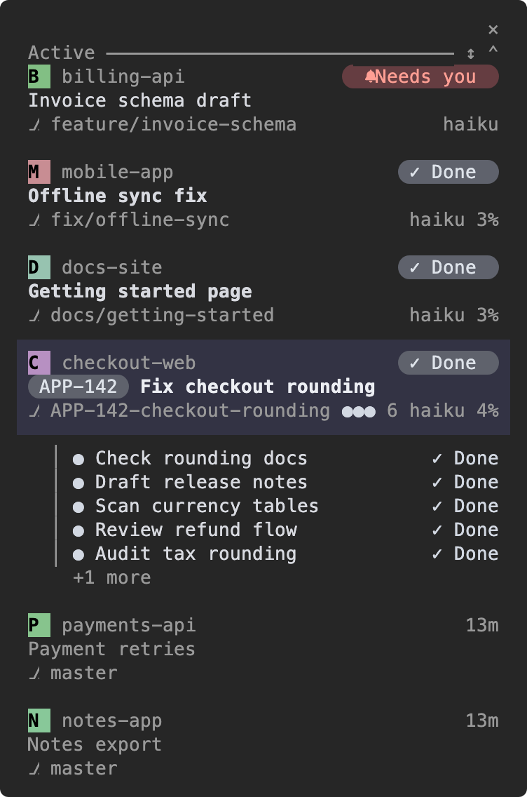
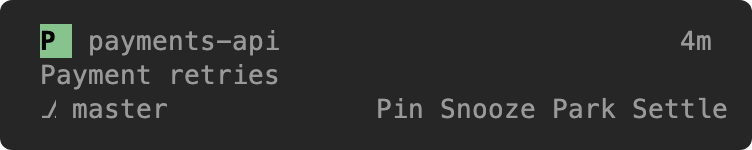
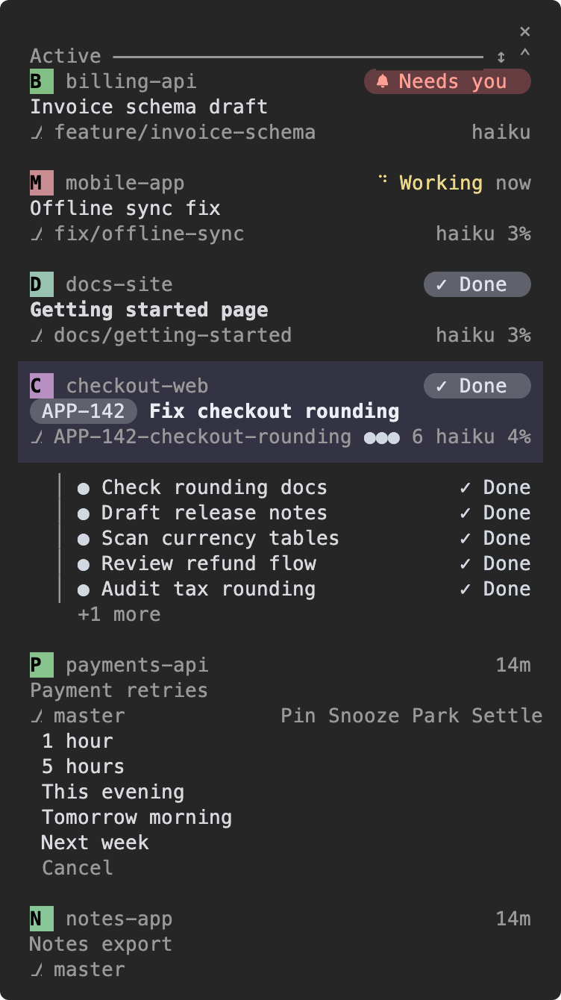
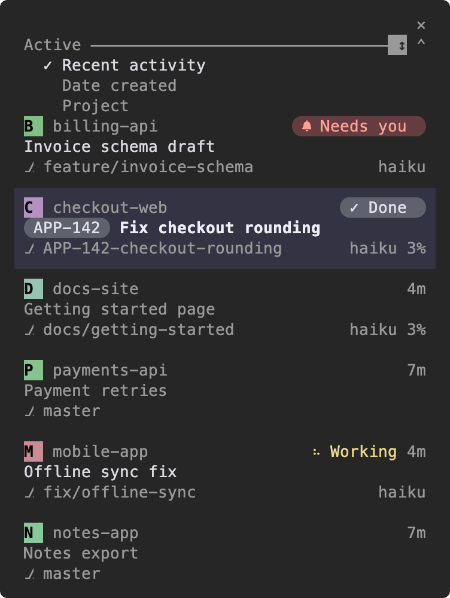
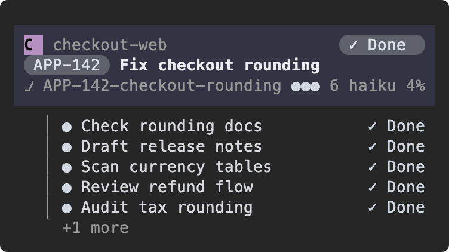
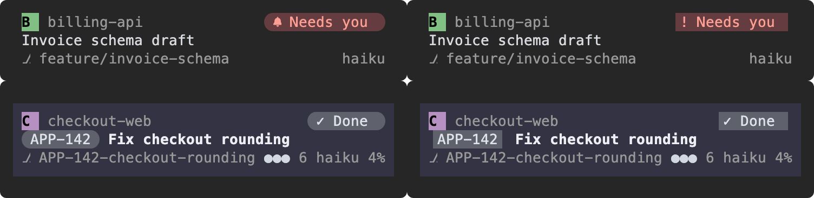
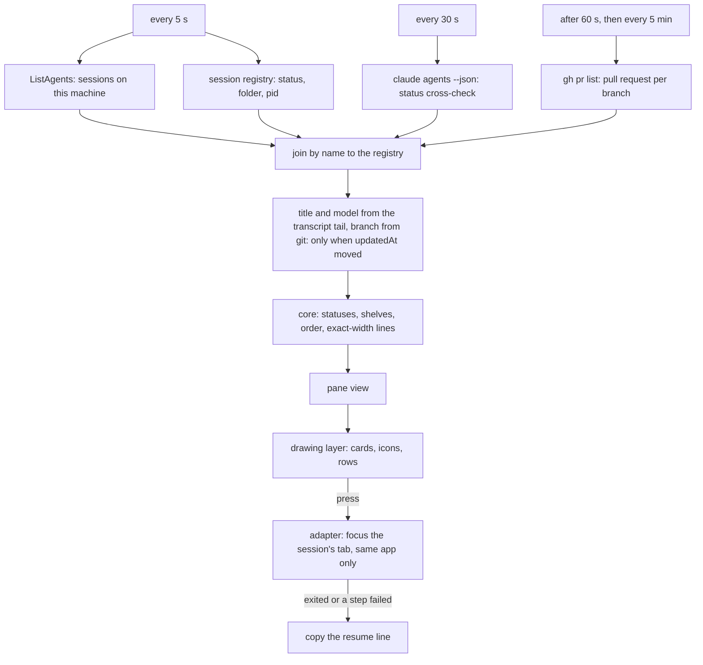

# Bridge

Bridge is a docked Claude Code pane that lists this machine's sessions as cards. It puts their status, title, project, and context use beside the chat that is open now.

It removes terminal-tab hunting when several sessions run at once. A card tells you which session needs an answer, is still working, or has finished.

Bridge is for people who run Claude Code work across projects, subagents, or background tasks.


*Bridge beside the Claude Code chat. This dark picture uses Nerd glyphs. The coloured initial is the project icon or monogram; `×` closes the pane.*

## What Bridge is for

### Find the one session that needs you

When sessions run in several projects, Bridge puts **Needs you** at the top. The red bell pill means the session is waiting for an answer; opening its card takes you to the session when it is eligible for focus.


*A question is visible without opening every terminal tab. Gain: respond to the right session first.*

### Keep a subagent fan-out in view

Your current session can show child rows below its card. The moving yellow dots mean child work is running; completed rows remain, and `+1 more` means one additional child is hidden.


*Example subagent progress. Gain: see the work still running and the work already completed.*

### Decide when a long conversation needs a fresh start

Bridge helps in two ways.

- **It shows how full the context is.** The percentage at the right of the card's third line is the share of the model's context window that the session uses.
- **It warns at a limit you choose.** The soft limit is the number of tokens at which you want to start a fresh session. The percentage turns orange at 75% of your limit and red when the session reaches it. Set it with `/bridge soft-limit 150k`; the defaults are under [Context warnings](#context-warnings).

The colour follows your soft limit, not the window. On a model with a large window, the percentage can still be small when the card turns red.


*One growing session with a soft limit of 100k tokens on a model with a 1M-token window: muted below 75k tokens, orange from 75k, red from 100k. Gain: start a fresh session at the point you chose, before context becomes unwieldy.*

## Install

Add the marketplace once, then install Bridge.

```sh
claude plugin marketplace add dbohorquez8/ai
claude plugin install bridge@dbohorquez
```

Start a new Claude Code session. Bridge opens automatically; type `/bridge` to open it again.

| Requirement | Detail |
|---|---|
| Claude Code | 2.1.302 or later |
| Docked layout | A fullscreen terminal at least 110 columns wide; narrower windows show the pane above the prompt |

The full list is under [Requirements](#requirements).

## Read a card

Each ordinary session uses three lines: project and status, title, then branch plus available details. The selected card is your current session and has a filled background. In this picture, `APP-142` is the ticket chip, the three dots and `6` are the subagent badge and count, `haiku` is the model, and `4%` is context use.



*The full card and its child rows, in dark Nerd-glyph mode.*

### Statuses

A status tells you what a session is doing and whether it needs anything from you. Each card shows exactly one status at the right end of its first line. The time next to a status counts from the moment the session entered it, not from when the pane opened.

| Status | What you see | What it means | When it ends |
|---|---|---|---|
| **Needs you** |  | The session is waiting for you: a permission prompt, a plan to approve, or a question. A turn that ends by asking you something counts too, and so does a subagent of your own session that waits for you. | You answer in the session, or you press the card of a session that asked a question. |
| **Working** |  | The session is running a turn. | The turn ends. |
| **Check?** |  | Your own session's background work has stayed silent past a threshold (15 minutes by default; see `/bridge check-after`), so it may need a look. | The background tasks end. |
| **Failed** |  | The session's last turn ended on an error, for example an API error. | On your own card: you press it, send the next prompt, or a later turn ends well. On another card: that session starts its next turn. |
| **Background** |  | Your own session finished its turn while background tasks still run. Only your own card shows it, with the tasks listed below it. | The tasks end, or the work stays silent for the Check? threshold. |
| **Done** |  | The session finished a turn that you have not looked at yet. | You press the card; it becomes Idle. |
| **Idle** |  | Nothing is going on, and you have already seen the last result. | The session starts working again. After 6 hours without activity, it moves to the Inactive shelf. |

When more than one status could apply, Bridge shows the one listed first in the table. Working shows only while a turn runs; the statuses below it show only when no turn runs. Needs-you cards always sort to the top of the Active shelf, longest wait first, and a card that changes to Needs you or Failed plays the chime.

Two more labels appear in the same place on cards you put aside. A snoozed card shows the time left before it returns, such as `2h`. A card that returned from snooze shows **Woke** until you press it.

When space is tight, Bridge removes context, pull request, model, and the subagent badge before shortening the branch. A card in another terminal app is dimmed and names that app. The notice line below the list is not pictured; it explains an action result or a focus problem.

## Act on a card

Press a normal session card to focus its tab only when it runs in the same supported terminal app as this pane. A live session in another app shows a notice and copies nothing. If the session exited, or focusing fails, Bridge copies a resume command and explains the result in the unpictured notice line; it never resumes the session itself. Press a child row to show that child’s transcript in the main view.

Hover an idle or done card to reveal actions. **Pin** keeps it at the top; **Snooze**, **Park**, and **Settle** hide it until a later change. Working and Needs-you cards cannot be hidden this way.



*The hover actions appear on the third line of an eligible card.*

Snooze offers 1 hour, 5 hours, This evening, Tomorrow morning, Next week, and Cancel. A snoozed card returns when its time expires, or sooner when it starts working or needs you; the returned card says **Woke**. Pressing a done or woke card clears its mark. Woke is not pictured.



## Shelves and sorting

A shelf is a named group of cards. Press its header to open or collapse it; a collapsed shelf shows a count and no cards. Pinned, Active, and Working start open. Inactive, Snoozed, Parked, and Settled start collapsed, and the layout is shared across panes.


When Active is empty, Bridge shows an illustrated all-clear or working scene; it is not pictured because the current session remains visible. Scenes need 24-bit color; without it the caption shows alone.

| Shelf | Contains |
|---|---|
| Pinned | Cards you pinned. |
| Active | Needs-you, failed, idle, done, woke, and—when the Working shelf is off—working sessions. |
| Working | Working sessions as one-line cards when `/bridge working-shelf on`; it is off by default. |
| Inactive | Idle sessions after 6 hours. Not pictured. |
| Snoozed | Snoozed cards; the right side shows time remaining. |
| Parked / Settled | Cards you put aside; they return to Active when they start working, need you, or finish. |

Use `↕` on the Active header to choose Recent activity, Date created, or Project. Needs-you cards always stay first, ordered by longest wait. Pinned cards alone can be manually reordered with their `↑` and `↓` controls, which are not pictured.



## Subagents and background work

Child rows appear below your own session's card only. Each shows its description, status, and age. A child that waits for a permission, a plan approval, or an answer shows **Needs you**, and so does your card, chime included. Up to five child rows appear, then `+N more`; finished rows stay for the rest of the session (the 20 most recent).

Background tasks, such as a command, a monitor, a workflow, or an agent started in the background, also appear below your own card only. Each row starts with `⟳` and shows the task's description and age. Up to three appear, then `+N more`; they are not pictured. When your turn ends while one still runs, your card shows **Background**. If the work stays silent for the configured threshold, it becomes **Check?**.

## The chime

Bridge plays one short chime on macOS when a card changes to Needs you or Failed. It stays silent for Snoozed, Parked, or Settled cards, and for a card that already existed when the pane opened. A newly appearing card that already needs you can chime.

Every open session has a pane, but only one claims each chime. Other operating systems play nothing. Use `/bridge sound off` to disable it.

## Settings and modes

Bridge keeps these choices across sessions. The pane has no settings rows; every setting is a `/bridge` argument.

| Command | Values | Default | Effect |
|---|---|---|---|
| `/bridge icons` | `on`, `off` | `on` | Shows project icons or monograms. |
| `/bridge working-shelf` | `on`, `off` | `off` | Separates working sessions onto their own shelf. |
| `/bridge theme` | `auto`, `light`, `dark` | `auto` | `auto` follows Claude Code’s theme. |
| `/bridge glyphs` | `auto`, `nerd`, `plain` | `auto` | Changes status-pill caps and the Needs-you bell. |
| `/bridge tickets` | prefixes or `off` | `off` | Shows matching ticket chips. |
| `/bridge soft-limit` | token count or `off` | 100k or 300k | Controls context warning colors. |
| `/bridge check-after` | whole minutes or `off` | 15 | Changes how long Background waits before it becomes Check?. |
| `/bridge sound` | `on`, `off` | `on` | Enables or disables the chime. |

With `theme auto`, a Claude Code theme whose name starts with `light` is light and anything else is dark. Every color the pane picks is adjusted until it reaches a 4.5:1 contrast ratio against the pane background.

### Ticket chips

A ticket chip is an optional label that shows an issue id, such as `APP-142`, before the card's title. Turn chips on by naming your id prefixes with `/bridge tickets APP-,OPS-`; Bridge then looks for a matching id in the session's title or branch. `/bridge tickets off` hides chips.



### Context warnings

The context percentage measures the text held in the model’s context window. The configured soft limit turns it orange at 75% and red at 100%.

| Context window | Default soft limit |
|---|---|
| Up to 200k tokens, or unknown | 100k tokens |
| Above 200k tokens | 300k tokens |

If Bridge does not know the token count, color follows the displayed window percentage instead. Set a value with `/bridge soft-limit 150k`, or use `/bridge soft-limit off` to measure against the full window.

Quality drops gradually as context grows, well before the window is full ([Anthropic](https://platform.claude.com/docs/en/build-with-claude/context-windows), [Chroma](https://www.trychroma.com/research/context-rot)). Practitioners commonly stop around 100k tokens on 200k-window models and around 300k-400k on 1M-window models ([Dex Horthy, The Pragmatic Engineer](https://newsletter.pragmaticengineer.com/p/context-engineering-with-dex-horthy)). Bridge's defaults follow that.

### Nerd and plain glyphs

The pictures on this page use Nerd glyphs, the look used by Ghostty and iTerm2 in auto mode. Plain glyphs use square-ended pills and `!` instead of the bell; choose `/bridge glyphs plain` when your iTerm2 font lacks Powerline glyphs.



## Compatibility

Bridge can focus tabs in cmux, tmux, Ghostty, Terminal.app, and iTerm2. It focuses only within the same terminal app. Project pictures need 24-bit color and work in Ghostty, cmux, kitty, and iTerm2 with `CLAUDE_CODE_FORCE_TERMINAL_IMAGES=1`; tmux and Terminal.app use monograms instead.

### Terminal support

| Terminal | Tab focus | Project pictures | Scenes |
|-------|-------|-------|-------|
| **cmux** | Yes | Yes | With 24-bit color |
| **tmux** | Yes | Monograms | With 24-bit color |
| **Ghostty** | Yes | Yes | With 24-bit color |
| **Terminal.app** | Yes | Monograms | No |
| **iTerm2** | Yes | With `CLAUDE_CODE_FORCE_TERMINAL_IMAGES=1` | With 24-bit color |
| **kitty** | No | Yes | With 24-bit color |
| **Anything else** | No | Monograms | With 24-bit color |

Tab focus works only within the same terminal app. In a terminal without tab focus, lists, shelves, sorting, and statuses all work, and pressing a card copies a resume command instead.

### Requirements

- Claude Code 2.1.302 or later.
- A fullscreen terminal at least 110 columns wide to dock Bridge beside the chat; in a narrower window, it appears above the prompt.
- macOS for the chime, and for tab focus in Ghostty, Terminal.app, and iTerm2. Bridge is tested on macOS.
- 24-bit color for project pictures and scenes. Without it, Bridge uses monograms and shows scene captions alone.
- Optional: the GitHub CLI `gh`, signed in, to show pull request numbers.

## How it works

This section is for readers who want the internals: how the pane reads its data, how each terminal is focused, and where project icons come from.

### Architecture



The code is split so that nothing outside one folder knows about the terminal.

| Layer | Folder | Job |
|-------|--------|-----|
| **Core** | `hooks/core/` | Pure logic: merges the sources, decides statuses and shelves, orders cards, builds every line to its exact width, picks colors and animation frames. Knows no terminal and no runtime handle. |
| **Drawing** | `hooks/render/` | Paints the core's view model as Claude Code elements. Decides nothing. |
| **Adapters** | `hooks/adapters/` | One file per terminal (cmux, tmux, Ghostty, Terminal.app, iTerm2): finds a session's tab, focuses it, and says what the terminal can draw. |

`hooks/register.tsx` is the only file that talks to Claude Code (timers, store, pane); it wires the
layers together.

An unrecognised terminal still gets every list, shelf, sort and status rule; it only loses tab
focus.

### Data sources

- **Session registry** (every refresh). Every 5 seconds the mod reads Claude Code's session
  registry, `~/.claude/sessions/*.json` (`sessionId`, `name`, `cwd`, `pid`, `status`, `updatedAt`,
  `statusUpdatedAt`, `waitingFor`, and `contextPercent` when present), with `cat` through
  `$.process` (under `$CLAUDE_CONFIG_DIR` when that is set). Token files in the same folder are
  never opened. **The registry is internal and undocumented**: it can change in any release. When it
  cannot be read, or a name is missing or appears twice, the card keeps its name and says resume is
  unavailable; a ref is never shown as an id.
- **`ListAgents`** (every refresh). Gives a short ref, not a session id, so the mod joins each row by
  name to the registry. It leaves out the calling session, whose card comes from its own registry
  entry. Its `subagents` and `teammates` sections are skipped: those agents are child rows, never cards.
- **`claude agents --json`** (every 30 seconds, first run 30 seconds after session start). A
  cross-check of each session's status. It runs on its own timer, never inside the 5-second refresh,
  because each call costs about 0.17 CPU-seconds. Background entries are ignored. If the command is
  missing or prints nothing readable, the registry alone decides. When it and the registry disagree,
  the source that changed more recently wins.
- **Transcript tail** (only when a session's `updatedAt` moved). Reads the last 256 KB of
  `<config dir>/projects/<slug of cwd>/<sessionId>.jsonl` for the title and the model, in every
  mode; the whole file is never read. The title is the last `ai-title` record, else the first line
  of the `last-prompt` record, else the session's name.
- **Git** (only when a folder's newest `updatedAt` moved). The branch and the project name per
  folder; a worktree takes its main checkout's name.
- **Context window.** This session's window comes from its usage; another session's window is the window reported for its model. Another session's window above 200k counts only when its model id carries `[1m]`; otherwise it takes 100k.
- **Ticket chips.** A matching id is looked for at the start of the title, then the branch, then the worktree name.
- **Pull requests.** `gh pr list --head <branch> --state all --json number --limit 1`, one process per
  distinct folder and branch (at most 10), first run 60 seconds after session start, then every
  5 minutes. A missing or signed-out `gh` turns lookups off for the rest of the session.
- **This session.** `$.agent.list()` for subagents, `$.session.usage()` for context use,
  `turn.start` and `turn.complete` for whether a turn runs and whether it ended on an API error (Failed; an
  answered turn or your next prompt clears it), and its background tasks from the tool calls
  that start them, the task notifications that end them, and the `background_tasks` of a `Stop` or
  `SubagentStop` hook when one runs. A clear or resume drops the background rows; once the session is
  idle with no turn running, a task whose end went unseen is dropped.
- **Project icons.** `$.fs` checks the candidate files and their size; one `sh` process measures and
  converts a picture not yet cached (`sips`, `rsvg-convert` for SVG as a fallback).
- **Plugin store** (`$.store`). One entry per session (`pref:<session id>`, holding pin, park,
  settle and snooze), plus `shelves`, `sort`, `layout` (the pinned order), `setting:icons`,
  `setting:theme`, `setting:tickets`, `setting:softLimit` and `scene:caption`. Every write changes one entry only, so two panes changing
  different sessions both persist; for the same entry the later save wins. A value that fails its
  check is replaced by its default and the note reads `The saved layout was reset.` Entries of
  sessions not seen for 30 days are deleted.

A refresh where no session changed starts at most two processes. All the changed sessions are read
in one process, and all the changed directories in another.

A chime is claimed in the shared store (`chime:<id>`), and only the first session to claim it
chimes. A known limit: the claim names the registry's status time, so a session with no registry
entry, or whose `claude agents` listing leads the registry, can miss a repeat chime.

### Dependencies

- Claude Code 2.1.302 or later (hooks modules, `ListAgents`, docked panes).
- A fullscreen terminal of 110 columns or more for the pane to dock beside the transcript;
  narrower, it sits above the prompt. The pane asks for a 44-column dock; a width you drag wins.
- Claude Code's internal session registry, `~/.claude/sessions/*.json`, for session ids and
  resume lines. It is undocumented; if a release changes it, cards still list but say resume is
  unavailable.
- 24-bit color (`COLORTERM=truecolor` or `24bit`) for project pictures and scenes.
- macOS `sips` (and `rsvg-convert` for some SVGs) to convert project pictures (without them, monograms show).
- `tail`, `grep` and `git` for titles, models and branches.
- Optional: the `claude` CLI on `PATH` for the status cross-check, and `gh` (signed in) for pull
  request numbers.
- To focus tabs: `ps` and `sh`; the `cmux` CLI or `tmux` for those hosts; macOS with `osascript`
  for Ghostty, Terminal.app and iTerm2. Tested on macOS.

### Pressing a card

Pressing a session card first tries to focus the session's tab (see
[Focusing a session's tab](#focusing-a-sessions-tab)). When that cannot happen, it copies
`cd '<cwd>' && claude --resume <sessionId>` (`--resume` looks a session up per project directory)
and shows it under the list. The mod never resumes a session by itself, because Claude Code refuses
to open a session that another process holds. Pressing this session's own card returns the main
view to this session.

### Focusing a session's tab

The pane finds its own terminal once at session start: cmux by its `CMUX_*` variables (these win
over `TERM_PROGRAM=ghostty`, as cmux embeds Ghostty), tmux by `TMUX` and its server socket, else the
terminal app among its parent processes, else `TERM_PROGRAM`. A press focuses a session only when
the session runs in that same place: the same app; for tmux, the same tmux server socket; for cmux,
the same cmux instance (`CMUX_SOCKET_PATH`), any workspace.

A live session anywhere else makes no call and copies nothing: Claude Code would refuse to resume a
session that runs in another terminal. Its card is drawn dim with the app's name after the project,
and a press says `<name> runs in <app>` under the list (`another tmux server`, `another cmux` for the
same app on another socket). A live session in an unrecognised terminal says
`<name>: terminal unknown`.

During each 5-second refresh the mod looks up every new session's process (the registry `pid`)
with one `ps` call for all of them and finds its terminal: first from the process's environment
(`CMUX_SURFACE_ID`, `CMUX_SOCKET_PATH`, `TMUX`, `TERM_PROGRAM`), then from its parent processes.
Only those variable names are read; the rest of the environment is never kept or shown. The result
is kept in memory per `pid` and registry `startedAt`, and dropped when the session leaves the
registry, so a press runs no lookup. A press that finds nothing kept looks the process up then.
Each terminal's focus steps run as one process, so a cached cmux press runs exactly one command.

Every terminal below switches within the same app only.

| Terminal | How the tab is found | Permission |
|-------|-------------|------------|
| **cmux** | The workspace and surface ids in the session's environment (else its tty in `cmux tree --all --json`), then `select-workspace` and `focus-panel` in one `sh -c` call that first checks the process still runs. The CLI is looked for at `$CMUX_BUNDLED_CLI_PATH`, then `/Applications/cmux.app/Contents/Resources/bin/cmux`, then `cmux` on `PATH` | None |
| **tmux** | The pane whose tty is the session's (panes and clients in one `tmux` call), then `select-window` and `select-pane` (`switch-client` when the client shows another session) in one more `tmux` call | None |
| **Ghostty** | One AppleScript call: the terminal whose working directory is the session's folder, **when exactly one terminal has it**. Two tabs in one folder are told apart by the session's title when it is unique; otherwise the press says `Ghostty: the folder is shared by 2 tabs` | None |
| **Terminal.app** | AppleScript: the tab whose `tty` is the session's | One-time macOS Automation prompt ("… wants to control Terminal") |
| **iTerm2** | AppleScript: the session whose `tty` is the session's, with its tab and window | One-time macOS Automation prompt ("… wants to control iTerm2") |

The Automation prompt names the terminal app that runs Claude Code, not Claude Code. If it was
declined, the note under the list says so; allow it in **System Settings > Privacy & Security > Automation**.

Other hosts (VS Code, Cursor, kitty, WezTerm, a session with no terminal) are not supported for
switching: a live session there gives `<name>: terminal unknown`, and a press from a pane in such a
host copies the resume line. A session whose process has exited copies the resume line.

### Project icons

A card's first line starts with the project icon, 2 columns wide and 1 line tall, then one space,
then the project name; the Working shelf's one-line cards carry it too. The icon is the project's own
picture: the first of the candidate files (`favicon.svg`, `favicon.ico`, `favicon.png`,
`icon.svg`, ... `.idea/icon.svg`) that exists in the project's folder (the main checkout for a
worktree). It is converted once to a 64-pixel PNG in `${CLAUDE_CONFIG_DIR:-~/.claude}/bridge/icons/`
(`sips`, with `rsvg-convert` as a fallback for SVG) and each folder is looked at again at most every 10 minutes.

To give a project an icon, put a square SVG, PNG or ICO of at least 64 pixels at one of those paths,
for example `favicon.svg` or `public/favicon.png`. Two limits keep the lookup cheap: a file over 1 MB is
skipped and the next candidate is tried, and a PNG or ICO wider or taller than 1024 pixels is not
converted, so the card shows the project's letter instead. An SVG has no pixel size, so only the 1 MB
limit applies to it.

A picture is drawn where the terminal draws pictures and 24-bit color: Ghostty, cmux and kitty;
iTerm2 when Claude Code started with `CLAUDE_CODE_FORCE_TERMINAL_IMAGES=1`; never inside tmux or in
Terminal. Elsewhere, or when the project has no picture, the icon is a monogram: the project name's
first letter (generic leading words skipped) on the project's color. Below 30 columns icons are hidden.
Animation runs at 10 frames per second at most, and only while something visible moves.

### Files

| Path | What |
|---|---|
| `hooks/register.tsx` | The hooks module and the only file that talks to Claude Code: session start, the timers, `/bridge`, the pane, the store |
| `hooks/core/` | Pure core: widths, ages, statuses, source merge, shelves and snooze, order, saved state, captions, exact-width lines, the view model, Next, palette, raster, project icons, scene art and animation |
| `hooks/render/` | The drawing layer: pane, shelves, cards, subagent rows, art, notes |
| `hooks/adapters/` | One file per terminal, plus the shared probe, the capability check and the Nerd-or-plain glyph choice |
| `hooks/sidebar-policy.ts` | Pure logic: `ListAgents` rows, the registry join, the resume line |
| `hooks/card-policy.ts` | Pure logic: title, model and branch readers and their caches |
| `hooks/relative-time.ts` | Adapted (see THIRD_PARTY_NOTICES.md): the age label |
| `hooks/project-colors.ts` | Adapted (see THIRD_PARTY_NOTICES.md): the stable, distinct project colors |
| `hooks/focus-policy.ts` | Re-exports the adapters under the names the unit tests import |
| `types/index.d.ts` | The pane's state contract |
| `assets/` | The pictures on this page |
| `tests/` | `claude plugin test plugins/bridge` |

## Third-party notices

Parts of this plugin are adapted from MIT-licensed code. The copyright notices and license text
are in [THIRD_PARTY_NOTICES.md](THIRD_PARTY_NOTICES.md).
