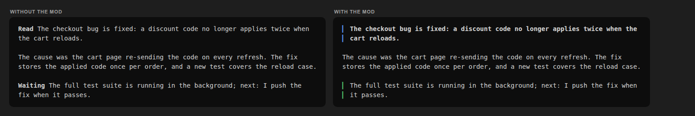
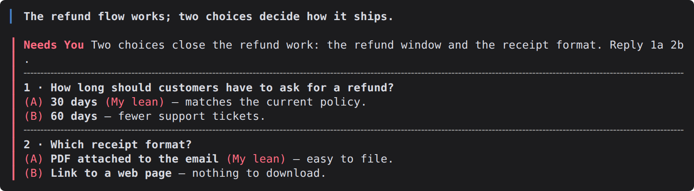
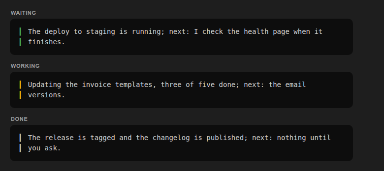

# reply-style

A Claude Code mod that makes structured replies easy to scan in the terminal. It finds three kinds of marker in
Claude's reply and draws each one as a colored bar: the answer at the top, the question that needs you, and the line
that says whether work is still running.



## What it draws

| Marker in the reply | What the terminal shows |
| --- | --- |
| `**Read** <answer>` as the first paragraph | The answer in bold behind a blue bar; the word Read is dropped. |
| `**Needs You** <question>` and the lettered options after it | A red bar down the whole block, red option letters, a dashed line between numbered questions. |
| `**Waiting**`, `**Working**` or `**Done**` as the last paragraph | The sentence behind a green (Waiting), yellow (Working) or plain (Done) bar; the word is dropped. |

Everything between the markers is drawn by Claude Code as usual. A reply with no markers is left alone, and so is
every surface other than the terminal. Colors come from your Claude Code theme, so they follow light and dark themes.

A question block:



The three closing lines:



## What the markers mean

The markers are a reply contract between you and Claude. Each one answers a question you have when you glance at a reply.

- **Read**: what happened? The first paragraph is one sentence with the answer, result or recommendation. If you
  read nothing else, you read this.
- **Needs You**: what do you have to decide or do? Everything you must act on is in this block, never only in the
  body or a linked file. Each question offers lettered options, and the recommended one is marked `(My lean)`.
- **Waiting**, **Working**, **Done**: what happens next? A reply that asks nothing ends with exactly one of these.

The three closing words differ in whether Claude is still busy and whether anything is still running:

| Line | Claude's turn | Something still running | What you do |
| --- | --- | --- | --- |
| **Waiting** (green) | Over. Claude is free to talk. | Yes: a child agent, a background build, a test run, a CI watch that Claude started. | Nothing. Claude reports when that work finishes; you can send other work meanwhile. |
| **Working** (yellow) | Not over. This is a progress update in the middle of a long task. | Claude itself. | Nothing. Claude keeps going and is busy until its next update. |
| **Done** (plain) | Over. | Nothing: no child, no background command, no queued step. | Whatever you like; nothing waits on you or on Claude. |

The short version: **Waiting** means "I've stopped, but something I started is still going"; **Working** means "I
haven't stopped". A reply with a Needs You block has no closing line, because the next step is yours.

## Getting replies in this shape

The mod only draws; it does not tell Claude how to write. Replies get the markers from your output style or
instructions. A reply the mod styles looks like this in plain markdown:

```markdown
**Read** The checkout bug is fixed: a discount code no longer applies twice.

The cause was the cart page re-sending the code on every refresh.

**Waiting** The full test suite is running in the background; next: I push the fix when it passes.
```

The rules the mod reads:

- **Read** is the first paragraph's bold lead.
- **Needs You** starts the action block. Options are bold `(A)`, `(B)` … leads, and the recommended one ends its bold
  text with `(My lean)`. Numbered questions use a bold `1 · Question?` header.
- **Waiting**, **Working** or **Done** is the last paragraph's bold lead. A reply with a Needs You block has no such line.
- A lead counts only when it is the exact capitalised word followed by a space, a line break or the end of the paragraph.

## Install

```sh
claude plugin marketplace add dbohorquez8/ai
claude plugin install reply-style@dbohorquez
```

Restart Claude Code to load it. To turn it off: `claude plugin disable reply-style@dbohorquez`; to remove it:
`claude plugin uninstall reply-style@dbohorquez`.

## Limits

- The bars appear when a reply finishes, not while it streams. Claude Code draws streaming text itself and raises
  `ui.render` for an `AssistantMessage` only once the block is complete (checked on 2.1.306 with `--debug-file`: no
  render dispatch until 3 ms before `turn.complete`). The classic `MessageDisplay` hook sees streamed lines, but it can
  only replace them with plain text, so it cannot draw colored bars.
- Tested on Claude Code **2.1.302** (`lib/version.ts`). On another version it prints one notice per version change.
- If the render hook fails or never runs, it prints one "inactive" notice per session. The check runs one turn late,
  because the host can raise `turn.complete` before the final reply's `ui.render`.

## Where the format comes from

The reply format comes from a personal Claude Code output style called `adhd-ish`, built for a reader who scans,
reads out of order, and wants the conclusion before the data. It grew in steps:

- **[Caveman](https://github.com/JuliusBrussee/caveman)** by Julius Brussee. The starting point: cut the padding at
  the level of the reply (no preamble, no recap, answer first). The first version of the style was named
  `my-caveman` after it.
- **Simplified Technical English (ASD-STE100).** The counterweight to Caveman: keep each sentence complete and explicit
  (subject, verb, article, one claim per sentence), so a short reply still parses on one reading.
- **[cc-stretch](https://github.com/pro-vi/cc-stretch)** by pro-vi, which brings Ted Nelson's 1967 idea of
  *stretchtext* to Claude Code: a short reply where each phrase grows when you click it. While working on reducing
  reply verbosity, we studied it closely and adapted its core rather than its machinery: a short opening that
  answers on its own became the **Read** marker, and the rule that anything you must act on is never hidden became
  the **Needs You** block. The closing state words go back to an earlier version of the style that used colored
  emoji (green, yellow, white) for the same three states.

Thanks to their authors. This mod is the terminal half of that work; a BB IDE plugin draws the same markers in BB.

## How it works

- Three hooks only: `ui.render` (AssistantMessage), `session.start`, `turn.complete`. No prompt hook: the reply rules
  reach the session through the output style.
- `lib/layout.ts` turns a reply's text and the terminal width into sections; the hook draws them with Claude Code's
  `Box`, `Text` and `Markdown` elements.
- `lib/markers.ts` is vendored byte for byte from the Workspace repo (`docs/reply-style/markers.ts`). Do not edit it here.
- The screenshots in `assets/` are drawn from `lib/layout.ts` itself, with Claude Code's dark theme colors approximated.
