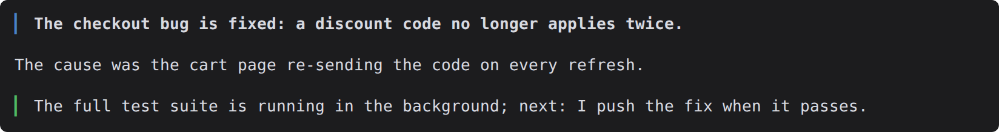
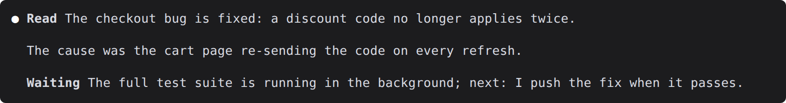

# reply-style

reply-style draws the answer, the question that needs you, and the "what happens next" line of a Claude Code reply as colored bars, so you find them at a glance.



*A reply with the mod, dark theme. The same reply without it is under [What it draws](#what-it-draws).*

## Install

```sh
claude plugin marketplace add dbohorquez8/ai
claude plugin install reply-style@dbohorquez
```

Restart Claude Code to load it. Replies only get bars when they use the markers below; [Getting replies in this shape](#getting-replies-in-this-shape) shows how.

## What it draws

Claude's reply carries three kinds of marker, each a bold word at the start of a paragraph. The mod finds them and leaves everything else to Claude Code.

| Marker in the reply | What the terminal shows |
| --- | --- |
| `**Read** <answer>` as the first paragraph | The answer in bold behind a blue bar; the word Read is dropped. |
| `**Needs You** <question>` and the lettered options after it | A red bar down the whole block, red option letters, a dashed line between numbered questions. |
| `**Waiting**`, `**Working**` or `**Done**` as the last paragraph | The sentence behind a green, yellow or plain bar; the word is dropped. |

The same reply without the mod shows the markers as plain text:



### The question that needs you

**Needs You** starts the part of a reply where you must decide or do something. Each question offers lettered options; the recommended one ends with `(My lean)`. Numbered questions are separated by a dashed line.


### What happens next

A reply that asks nothing ends with one of three words. They differ in whether Claude's turn is over and whether anything still runs.

| Line | Looks like | Claude's turn | Still running |
| --- | --- | --- | --- |
| **Waiting** |  | Over. | Yes: work Claude started, such as a build, a test run or a child agent. Claude reports when it finishes. |
| **Working** |  | Not over; a progress update. | Claude itself. |
| **Done** |  | Over. | Nothing. |

A reply with a Needs You block has no closing line, because the next step is yours.

## Getting replies in this shape

The mod only draws; it does not tell Claude how to write. Replies get the markers from an output style or your own instructions. The plugin ships an example style, [`examples/reply-markers.md`](examples/reply-markers.md). Download it, adapt it, and select it:

```sh
mkdir -p ~/.claude/output-styles
curl -fsSL -o ~/.claude/output-styles/reply-markers.md \
  https://raw.githubusercontent.com/dbohorquez8/ai/main/plugins/reply-style/examples/reply-markers.md
```

Then pick **reply-markers** under Output style in `/config` and start a new session. The rules the mod reads:

- **Read** is the first paragraph's bold lead.
- **Needs You** starts the action block. Options are bold `(A)`, `(B)` … leads; numbered questions use a bold `1 · Question?` header.
- **Waiting**, **Working** or **Done** is the last paragraph's bold lead; a reply with a Needs You block has none.
- A lead counts only when it is the exact capitalised word followed by a space, a line break or the end of the paragraph.

## Compatibility

Tested on Claude Code 2.1.302. On another version the mod prints one notice per version change; the pictures above were captured on 2.1.308. It draws only in the terminal; every other surface, and any reply without markers, shows as usual. Colors come from your Claude Code theme.

## Limits

- If the render hook fails or never runs, the mod prints one "inactive" notice per session. The check runs one turn late.

## What it touches

reply-style reads the text of each reply to draw it and stores one small value, the last Claude Code version it saw. Nothing leaves your machine.

## Credits and licence

The reply format builds on [Caveman](https://github.com/JuliusBrussee/caveman) by Julius Brussee (answer first, no padding), Simplified Technical English ASD-STE100 (complete, one-claim sentences), and [cc-stretch](https://github.com/pro-vi/cc-stretch) by pro-vi (a short opening that stands alone; never hide what you must act on).

MIT, see [LICENSE](../../LICENSE). Not affiliated with or endorsed by Anthropic.
